<picture>
  <source media="(prefers-color-scheme: dark)" srcset="./assets/source-dark.svg" />
  
</picture>

At Northern Trust I built an AI copilot that cut information retrieval time by **42%** and a conversational loan simulator serving **100+** end users. Before that I worked on backend of Webex Contact Center's agent assist platform, processing **2.5M** conversation events a day for **4,000+** agents across **25+** enterprise tenants.

```ts
const madhunika: Engineer = {
  name: "Madhunika Danam",
  role: "AI/ML Engineer",
  company: "Northern Trust",
  location: "USA",
  yearsShipping: 4,
  languages: ["Python", "SQL", "Java", "Go", "Bash", "Shell"],
  stack: ["FastAPI", "Flask", "LangChain", "LangGraph", "MLflow", "Kubeflow", "Airflow", "AWS Step Functions"],
  career: [
    { at: "Northern Trust", role: "AI Engineer", when: "Feb 2025 – Present" },
    { at: "Hexaware Technology", role: "AI/ML Engineer", when: "Jan 2022" },
  ],
  education: "M.S. in Computer Science and Information Technology, Sacred Heart University",
};
```

## `projects.map(explain)`

<details>
<summary><code>projects.guardrailGw()</code> OpenAI-compatible LLM gateway with PII redaction, prompt injection scoring and hash-chained audit logs</summary>

</details>

<details>
<summary><code>projects.keeper()</code> Kubernetes operator for scheduled, application-consistent PVC backups with S3 storage</summary>

</details>

<details>
<summary><code>projects.burnrate()</code> SLO engine with multiwindow multi-burn-rate alerting and Prometheus rule generation</summary>

</details>

<details>
<summary><code>projects.minirun()</code> Minimal OCI-style Linux container runtime with namespaces, cgroups and seccomp BPF</summary>

</details>

<details>
<summary><code>projects.swimring()</code> SWIM gossip membership with Lifeguard, consistent hashing and quorum-replicated cache</summary>

</details>

<details>
<summary><code>projects.purgedcv()</code> Walk-forward cross-validation with purging and embargo to measure time-series leakage</summary>

</details>

## `CHANGELOG.md`

### v2.0 · Northern Trust

*Feb 2025 – Present*

Built an AI copilot and RAG platform processing **250,000+** enterprise documents, reducing information retrieval time by **42%** and improving search accuracy by **37%**.

Built an AIO paydown simulator as a conversational interface using Python, RAG, AI agents, and n8n, serving **100+** end users.

Improved LLM response consistency by **31%**, reducing response latency by **36%**.

### v1.0 · Hexaware Technology

*Jan 2022 – Jun 2023*

Built backend and AI services for the Webex Contact Center agent assist platform, processing **2.5M** conversation and workflow events daily for **4,000+** agents across **25+** enterprise tenants.

Reduced p95 inference latency from 920 ms to 610 ms (**34%**).

Built offline and online evaluation pipelines across **1,500+** labeled scenarios and catching **12+** regressions before production.

## `npm ls --depth=0`

<p align="center">
  
</p>

## `contact()`

[`email`](mailto:madhunika.danam@belvionus.com) · [`github`](https://github.com/Danammadhunika)

## Projects

- [guardrail-gw](https://github.com/Danammadhunika/guardrail-gw) — An OpenAI-compatible LLM gateway in Go that redacts PII and secrets, scores prompt injection, filters streaming SSE safely, rate-limits per key and writes a…
- [purgedcv](https://github.com/Danammadhunika/purgedcv) — Purged, embargoed walk-forward cross-validation for time series that reports how much of a model's backtested skill was leakage, using a known-zero-signal…
- [docwhisper](https://github.com/Danammadhunika/docwhisper) — Local semantic search over your own documents. Index a folder of PDFs / Markdown / text, search it in plain English, ask it questions — no cloud, no server, no…
- [keeper](https://github.com/Danammadhunika/keeper) — A Kubernetes operator in Go for scheduled, application-consistent backups of PVC workloads, with CSI snapshot and file-copy drivers, retention policies, S3…
- [burnrate](https://github.com/Danammadhunika/burnrate) — An SLO engine in Go that ingests OTLP metrics, runs multiwindow multi-burn-rate alerting with error budgets, and generates Prometheus rules verified to agree…
- [metricdiff](https://github.com/Danammadhunika/metricdiff) — Diff two snapshots of your metrics and fail the build when something moves too much.
- [plait](https://github.com/Danammadhunika/plait) — A compact declarative infrastructure-as-code engine in Go with an HCL-subset parser, dependency DAG, plan and apply, state locking, crash-safe recovery and…
- [swimring](https://github.com/Danammadhunika/swimring) — A from-scratch Go implementation of SWIM gossip membership with Lifeguard, a consistent-hash ring and a quorum-replicated cache, runnable over UDP or a…
- [minirun](https://github.com/Danammadhunika/minirun) — A minimal OCI-style Linux container runtime in Go that builds containers from namespaces, cgroup v2, overlayfs, pivot_root, capabilities and a self-written…
- [tagvault](https://github.com/Danammadhunika/tagvault) — An industrial process historian in Rust: Sparkplug B MQTT ingest, swinging-door compression with a proven error bound, Gorilla-encoded storage and a crash-safe…
